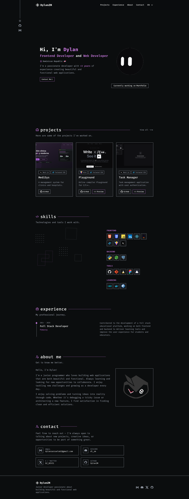

# Portfolio Demo

A personal portfolio website built with Astro and Tailwind CSS.

## Description

A fast, modern portfolio site that presents a professional profile: an about section, skills, work experience, a projects gallery, GitHub project listings, and a contact form. It ships with dark mode, smooth section animations, and full English/Spanish localization. Project and skill content live in simple data files, so updating the site does not require touching the components.

### Screenshots



## Getting Started


libraries:

- [Astro](https://astro.build) ^7.2
- [Tailwind CSS](https://tailwindcss.com) ^4.3
- [@lucide/astro](https://lucide.dev) and [morphicons](https://morphicons.com) for icons

### Installing

1. Clone the repository:

```sh
git clone https://github.com/DylanZM/portfolio-demo.git
cd portfolio-demo
```

2. Install dependencies:

```sh
npm install
```

3. execute program

```sh
npm run dev
```

Starts the local dev server at `localhost:4321`.


## Project Structure

```text
/
├── public/            # Static assets (favicons)
├── src/
│   ├── assets/        # Images and media
│   ├── components/    # UI sections (Hero, About, Skills, Experience, Projects, Contact, ...)
│   ├── data/          # Content data (projects, skills)
│   ├── i18n/          # Localization files (en, es)
│   ├── layouts/       # Page layouts
│   ├── lib/           # Helpers (GitHub API)
│   ├── pages/         # Routes (index, projects)
│   └── styles/        # Global styles
├── astro.config.mjs
└── package.json
```

```

## License

No license has been specified for this project yet. Contact the author for usage terms.
